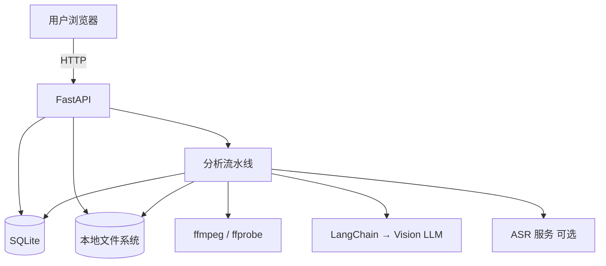
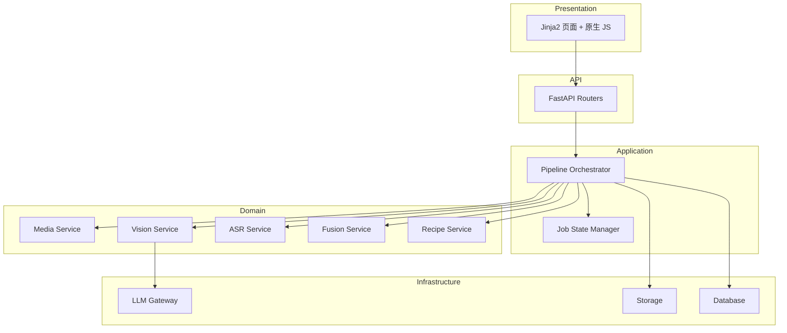
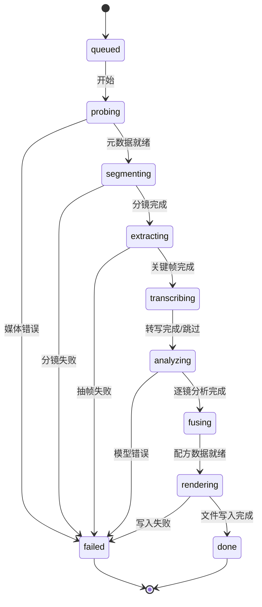
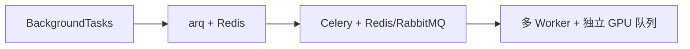
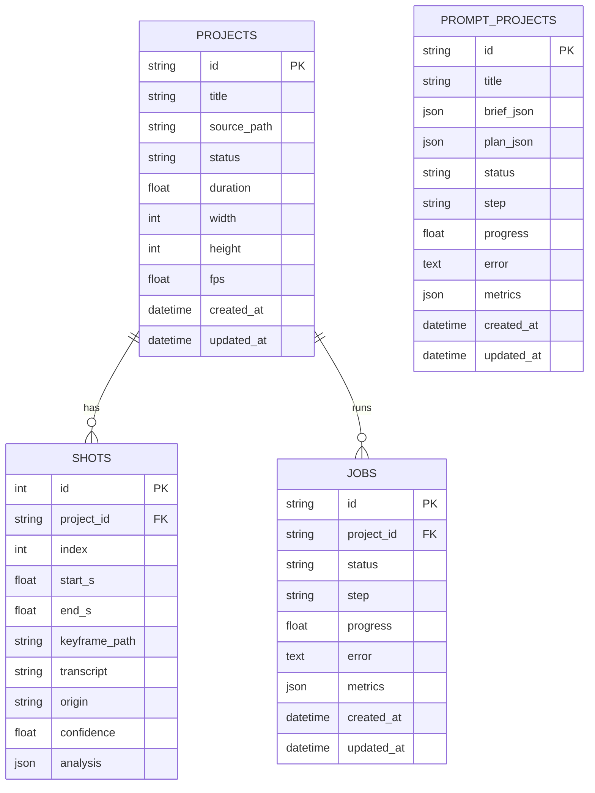

# 系统架构：ReelReverse

> 版本：v0.1  
> 目标：单机可跑、模块可替换、后续能平滑升级为多租户服务

## 1. 架构目标

1. **可跑**：没有 API Key 也能完整演示。
2. **可替换**：模型、ASR、存储、队列都能替换，不绑死供应商。
3. **可观测**：每个任务的每一步都有状态、耗时、错误和 token 统计。
4. **可扩展**：从单机后台任务平滑升级到任务队列和多租户。
5. **低成本**：按镜头控制调用量，关键帧压缩，避免无上限消耗。

## 2. 技术选型

| 层 | 选型 | 理由 | 备选 |
|----|------|------|------|
| Web 框架 | FastAPI | 异步、类型友好、自带 OpenAPI | Flask |
| LLM 编排 | LangChain 1.x + langchain-openai | 统一多供应商、结构化输出、LCEL | 直接 httpx |
| 数据校验 | Pydantic v2 | 与 FastAPI / LangChain 结构化输出一致 | dataclass |
| 数据库 | SQLAlchemy 2.0 + SQLite | 零运维，易迁移 Postgres | Postgres |
| 模板 | Jinja2 | 服务端渲染，无前端构建链 | Next.js |
| 前端 | 原生 JS + CSS | 零构建、部署简单 | React / Vue |
| 媒体处理 | ffmpeg / ffprobe | 事实标准，场景检测零额外依赖 | PySceneDetect |
| ASR | OpenAI 兼容接口 | 复用生态，可换本地 whisper | faster-whisper |
| 任务 | FastAPI BackgroundTasks | MVP 最简单 | arq / Celery |

## 3. 系统上下文



## 4. 分层架构



职责边界：

- **API 层**：参数校验、文件接收、序列化，不写业务逻辑。
- **Application 层**：编排流水线、推进任务状态、错误归类。
- **Domain 层**：纯业务能力，不依赖 FastAPI。
- **Infrastructure 层**：模型、数据库、文件、外部服务。

## 5. 核心流水线



每一步都写 `jobs.step`、`jobs.progress`、`jobs.updated_at`，前端轮询即可得到进度。

### 5.1 分镜策略

1. ffmpeg `select='gt(scene,threshold)',showinfo` 得到候选切点。
2. 去掉距离首尾过近的点。
3. 按 `min_shot_seconds` 合并过短镜头。
4. 超过 `max_shots` 时按时间均匀合并，避免成本失控。
5. 无 ffmpeg 或检测失败时，退化为等长切分。

### 5.2 逐镜分析

- 关键帧缩放到 768px 宽，转 base64 data URL。
- 一次调用只分析一个镜头，降低上下文干扰。
- LangChain `with_structured_output(ShotAnalysis, include_raw=True)` 拿到结构化结果和 usage。
- 结构化失败时降级到 `JsonOutputParser`。
- 仍失败则该镜头使用 Mock 结果并标注降级原因，不阻断整个任务。

### 5.3 音频与对齐

- 可选：抽取 16kHz 单声道音频，调用 ASR 得到带时间戳的片段。
- 按时间区间重叠把台词拼到对应镜头。
- v0.1 不做说话人分离，作为 v0.2 扩展点。

## 6. 模块职责

| 模块 | 文件 | 职责 |
|------|------|------|
| 配置 | `app/config.py` | 环境变量、路径、默认值 |
| 数据库 | `app/db.py` | Engine、Session、初始化 |
| 模型 | `app/models.py` | Project / Job / Shot / PromptProject |
| 数据结构 | `app/schemas.py` | 结构化输出、配方与提示词方案模型 |
| LLM 网关 | `app/services/llm.py` | 供应商适配、用量统计 |
| 媒体 | `app/services/media.py` | 探测、分镜、抽帧、抽音频 |
| 视觉 | `app/services/vision.py` | 逐镜分析、降级策略 |
| ASR | `app/services/asr.py` | 转写与时间戳 |
| 融合 | `app/services/fusion.py` | 台词对齐、节奏指标、摘要 |
| 配方 | `app/services/recipe.py` | Markdown / JSON 渲染 |
| 提示词生成 | `app/services/prompt_generation.py` | Brief 规划、结构化输出、Mock、时长归一化 |
| 提示词导出 | `app/services/prompt_export.py` | Markdown / JSON 渲染 |
| 流水线 | `app/services/pipeline.py` | 步骤编排、状态推进 |
| API | `app/api/routes.py` | 视频上传、查询、下载、删除 |
| 提示词 API | `app/api/prompt_routes.py` | 生成任务、查询、重生成、导出、删除 |
| 入口 | `app/main.py` | 应用装配、静态资源、页面 |

## 7. LangChain 设计

### 7.1 为什么用 LangChain

- 统一 OpenAI 兼容供应商（OpenAI / DeepSeek / 通义 / 私有网关）。
- 结构化输出直接映射到 Pydantic 模型，省掉手写 JSON 解析。
- LCEL 便于把"提示词 → 模型 → 解析"组合成可测试的链。
- 后续接 RAG、Agent、工具调用时不需要换框架。

### 7.2 关键代码形态

```python
llm = ChatOpenAI(model=..., api_key=..., base_url=..., temperature=0)
structured = llm.with_structured_output(ShotAnalysis, include_raw=True)
result = structured.invoke(messages)   # messages 含 text + image_url
parsed, raw = result["parsed"], result["raw"]
```

### 7.3 降级链

```
结构化输出 → JsonOutputParser → Mock 分析
```

任何一层失败都不会让整个任务失败，只会降低该镜头的质量，并在 `evidence` 中记录原因。

### 7.4 为什么 v0.1 不用 LangGraph

当前流水线是线性的，LangGraph 的状态机收益有限。等 v0.3 引入"生成 → 质检 → 重试"循环时，再把 `analyzing` 和 `rendering` 迁移为图节点。

## 8. 任务与并发

### v0.1

- `BackgroundTasks` 触发同步流水线，Starlette 在线程池中执行。
- 逐镜分析用 `ThreadPoolExecutor(max_workers=LLM_CONCURRENCY)`。
- 任务状态落库，前端每 1.5 秒轮询。
- 服务重启时，把 `running/queued` 的僵尸任务标记为失败。

### 升级路径



迁移时保持 `run_pipeline(project_id, job_id)` 接口不变即可。

## 9. 数据模型



设计说明：

- `analysis` 用 JSON 保存完整结构化结果，避免频繁加列。
- `origin` 和 `confidence` 单独列，便于统计和筛选。
- 一个项目可多次分析，保留历史 Job。
- 提示词方案独立存储在 `prompt_projects`，不依赖视频项目；完整 Brief 与方案分别保存在 JSON 列中。

## 10. API 设计

| 方法 | 路径 | 说明 |
|------|------|------|
| GET | `/healthz` | 健康检查、ffmpeg / LLM 状态 |
| POST | `/api/projects` | 上传视频并创建分析任务（multipart） |
| GET | `/api/projects` | 项目列表 |
| GET | `/api/projects/{id}` | 项目详情（含镜头与最新任务） |
| GET | `/api/projects/{id}/video` | 受控读取项目源视频 |
| GET | `/api/projects/{id}/shots/{shot_id}/keyframe` | 受控读取镜头关键帧 |
| POST | `/api/projects/{id}/analyze` | 重新分析 |
| GET | `/api/projects/{id}/recipe?format=md\|json` | 下载配方 |
| DELETE | `/api/projects/{id}` | 删除项目与文件 |
| GET | `/api/jobs/{id}` | 任务状态 |
| POST | `/api/prompt-projects` | 根据 Brief 创建提示词生成任务 |
| GET | `/api/prompt-projects` | 提示词方案列表 |
| GET | `/api/prompt-projects/{id}` | 提示词方案详情（含完整 plan） |
| POST | `/api/prompt-projects/{id}/regenerate` | 重新生成方案 |
| GET | `/api/prompt-projects/{id}/export?format=md\|json` | 下载提示词方案 |
| DELETE | `/api/prompt-projects/{id}` | 删除提示词方案 |
| GET | `/` | 工作台页面 |

约定：

- 上传成功返回 `202/201 + project_id + job_id`。
- 所有错误返回 `{"detail": "..."}`，中文可直接展示。
- 媒体 URL 使用项目级接口，不暴露绝对路径；不再公开 `/files/*`。

## 11. 存储布局

```
data/
├─ app.db
└─ projects/
   └─ {project_id}/
      ├─ source.mp4
      ├─ audio.wav
      ├─ frames/
      │  ├─ shot_0001.jpg
      │  └─ ...
      └─ output/
         ├─ video.md
         └─ video.json
```

- 目录名使用 UUID，避免路径穿越和重名。
- 附件通过受认证的项目级媒体接口读取，不能直接访问 `data/`。
- 生产环境可替换为对象存储，只需改 `Storage` 接口。

## 12. 可观测性

- 结构化日志：`时间 / 级别 / 模块 / project_id / job_id / 消息`。
- Job 指标：`calls`、`prompt_tokens`、`completion_tokens`、步骤耗时。
- PromptProject 指标：文本模型调用次数、输入 / 输出 token 与任务状态。
- 错误分类：`media_error`、`llm_error`、`asr_error`、`storage_error`。
- v0.2 接入 OpenTelemetry，把每步做成 span。

## 13. 安全与合规

- 扩展名白名单 + 大小限制 + 空文件校验。
- UUID 目录 + 删除前校验路径必须位于 `data/projects` 下。
- 上传文件不放入公开静态目录。
- `APP_PASSWORD` 非空时启用 HTTP Basic 认证，`/healthz` 保持公开。
- 生产环境继续增加：正式账号体系、租户隔离、上传限流、病毒扫描。
- 只分析用户主动上传的内容，不提供下载/搬运能力。
- 来源判定标注"模型推断"，不作为版权依据。

## 14. 性能与成本

| 手段 | 效果 |
|------|------|
| 关键帧缩放到 768px | 降低图片 token |
| `MAX_SHOTS=24` | 控制单视频调用上限 |
| 逐镜并发 2–4 | 缩短总时延 |
| 只取中点帧 | 每镜 1 张图 |
| Mock 模式 | 开发与演示零成本 |
| 结果落库 | 避免重复分析 |

粗略估算：20 个镜头 × 每镜约 1.5k input tokens + 300 output tokens，单视频成本远低于 ¥1（按主流视觉模型价格）。

## 15. 部署

单机 Docker：

```dockerfile
FROM python:3.11-slim
RUN apt-get update && apt-get install -y --no-install-recommends ffmpeg && rm -rf /var/lib/apt/lists/*
WORKDIR /app
COPY pyproject.toml README.md ./
COPY app ./app
RUN pip install --no-cache-dir -e .
COPY . .
EXPOSE 8000
CMD ["uvicorn", "app.main:app", "--host", "0.0.0.0", "--port", "8000"]
```

Nginx 反代时注意：

- `client_max_body_size 500m;`
- 上传接口超时 `proxy_read_timeout 600s;`
- 项目视频和关键帧接口可加私有缓存头

## 16. 目录结构

```
video-reverse-studio/
├─ app/
│  ├─ main.py
│  ├─ config.py
│  ├─ db.py
│  ├─ models.py
│  ├─ schemas.py
│  ├─ serializers.py
│  ├─ api/routes.py
│  ├─ api/prompt_routes.py
│  ├─ services/
│  │  ├─ llm.py
│  │  ├─ media.py
│  │  ├─ vision.py
│  │  ├─ asr.py
│  │  ├─ fusion.py
│  │  ├─ recipe.py
│  │  ├─ prompt_generation.py
│  │  ├─ prompt_export.py
│  │  └─ pipeline.py
│  ├─ prompts/
│  ├─ templates/
│  └─ static/
├─ docs/
├─ tests/
├─ data/
├─ pyproject.toml
└─ .env.example
```

## 17. 关键取舍

| 取舍 | 选择 | 原因 |
|------|------|------|
| 服务端渲染 vs SPA | Jinja2 + 原生 JS | 零构建、部署简单，MVP 足够 |
| SQLite vs Postgres | SQLite | 零运维；接口层已隔离，可平滑迁移 |
| 逐镜调用 vs 批量调用 | 逐镜调用 | 上下文更聚焦，失败影响面更小 |
| BackgroundTasks vs Celery | BackgroundTasks | MVP 简单；升级接口不变 |
| 来源判定用 LLM vs 专用分类器 | LLM | 无需训练数据；后续用评测集校准 |
| 直接生成视频 vs 只生成提示词/配方 | 只生成提示词/配方 | 复用文本模型能力，避免把成本与范围扩大到视频生成 |

## 18. 演进路线

- **v0.2**：多模态增强（音频情绪、BGM 节奏）、批量对比、相似镜头检索
- **v0.3**：接入视频生成模型，形成"分析 → 生成 → 质检 → 重试"闭环（此时引入 LangGraph）
- **v0.4**：多租户、团队空间、对象存储、队列化
- **v0.5**：来源判定评测集与回归看板，把准确率做成可量化指标
## 19. 私有网关适配（2026-11 验证）

当前默认走 OpenAI 兼容协议，已验证网关同时支持：

| 协议 | 路径 | 项目状态 |
|------|------|----------|
| OpenAI 兼容 | `/v1/chat/completions` | 已接入（`langchain-openai`） |
| Anthropic 原生 | `/v1/messages` | 可用，未接入（可加 `langchain-anthropic`） |

验证结果：

- `dashscope/qwen3.7-plus` 支持图片输入，逐镜视觉分析可正常返回结构化结果
- 结构化输出通过 OpenAI tool calling 成功，未触发降级
- 2 个镜头约消耗 2.9k input tokens / 1.6k output tokens
- 内网地址与密钥只存于 `.env`，不进入代码和示例文件

生产切换只需改环境变量：

```env
LLM_PROVIDER=openai
LLM_BASE_URL=https://your-gateway.example.com/v1
LLM_API_KEY=...
LLM_MODEL=...
VISION_MODEL=...
```

若生产网关只暴露 Anthropic 协议，新增一个 `AnthropicGateway` 分支即可，`LLMGateway` 的对外接口不变。
