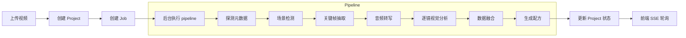
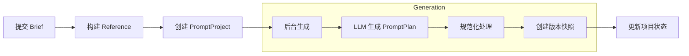

# ReelReverse 架构文档

> 版本：v0.1  
> 更新日期：2026-11-24

## 1. 项目概述

**ReelReverse** 是一个视频逆向工作台，核心功能是将任意视频拆解为可复刻的制作配方。用户上传视频后，系统自动进行分镜检测、关键帧抽取、逐镜分析，最终生成结构化的 `VIDEO.md` 和 `video.json` 配方文件。

### 1.1 核心价值主张

- **结构化输出**：不是简单的视频摘要，而是逐镜可执行的配方
- **来源判定**：自动判断镜头来源（实拍/AI生成/代码生成）
- **Mock 模式**：无 API Key 也可演示完整流程
- **私有部署**：支持完全本地化部署

### 1.2 目标用户

| 用户类型 | 核心场景 |
|----------|----------|
| 短视频编导 | 拆解爆款视频的节奏与镜头结构 |
| AI 视频创作者 | 反推素材的提示词和镜头语言 |
| 广告/影视前期 | 分析参考片的视觉方案 |
| 品牌内容团队 | 拆解竞品素材，形成内部模板 |

---

## 2. 技术栈

### 2.1 后端

| 组件 | 技术 | 版本要求 |
|------|------|----------|
| 运行时 | Python | ≥3.11 |
| Web 框架 | FastAPI | ≥0.115 |
| ORM | SQLAlchemy | ≥2.0 |
| 数据验证 | Pydantic | ≥2.7 |
| 配置管理 | pydantic-settings | ≥2.3 |
| LLM 框架 | LangChain | ≥0.3 |
| 模板引擎 | Jinja2 | ≥3.1 |
| HTTP 客户端 | httpx | ≥0.27 |
| 数据库 | SQLite（默认）/ PostgreSQL | - |

### 2.2 多媒体处理

| 功能 | 工具 |
|------|------|
| 视频探测 | ffprobe / ffmpeg |
| 场景检测 | ffmpeg select filter |
| 关键帧抽取 | ffmpeg |
| 音频提取 | ffmpeg |
| 语音识别 | OpenAI Whisper API（可选） |

### 2.3 前端

| 组件 | 技术 |
|------|------|
| 结构 | HTML5 |
| 样式 | 原生 CSS |
| 交互 | 原生 JavaScript（无框架）|
| 实时更新 | Server-Sent Events (SSE) |

---

## 3. 系统架构

### 3.1 整体架构图

```
┌─────────────────────────────────────────────────────────────────┐
│                         用户界面层                               │
│  ┌─────────────┐  ┌─────────────┐  ┌─────────────┐              │
│  │  index.html │  │  prompt.js  │  │  share.html │              │
│  │   app.js    │  │             │  │  share.js   │              │
│  └─────────────┘  └─────────────┘  └─────────────┘              │
└─────────────────────────────────────────────────────────────────┘
                              │
                              ▼
┌─────────────────────────────────────────────────────────────────┐
│                         API 路由层                               │
│  ┌─────────────┐  ┌─────────────┐  ┌─────────────┐              │
│  │   routes    │  │prompt_routes│  │share_routes │              │
│  │ (视频分析)  │  │ (提示词)    │  │ (分享)      │              │
│  └─────────────┘  └─────────────┘  └─────────────┘              │
└─────────────────────────────────────────────────────────────────┘
                              │
                              ▼
┌─────────────────────────────────────────────────────────────────┐
│                         服务层                                   │
│  ┌─────────────┐  ┌─────────────┐  ┌─────────────┐              │
│  │   media     │  │   vision    │  │     asr     │              │
│  │ (媒体处理)  │  │ (视觉分析)  │  │ (语音识别)  │              │
│  ├─────────────┤  ├─────────────┤  ├─────────────┤              │
│  │    llm      │  │   fusion    │  │   recipe    │              │
│  │ (LLM 网关)  │  │ (数据融合)  │  │ (配方生成)  │              │
│  ├─────────────┤  ├─────────────┤  └─────────────┘              │
│  │  pipeline   │  │   prompt    │  │              │              │
│  │ (流水线)    │  │ _generation │  │              │              │
│  └─────────────┘  └─────────────┘                               │
└─────────────────────────────────────────────────────────────────┘
                              │
                              ▼
┌─────────────────────────────────────────────────────────────────┐
│                         数据层                                   │
│  ┌─────────────┐  ┌─────────────┐  ┌─────────────┐              │
│  │   models    │  │   schemas   │  │     db      │              │
│  │ (ORM 模型)  │  │ (Pydantic)  │  │ (数据库)    │              │
│  └─────────────┘  └─────────────┘  └─────────────┘              │
└─────────────────────────────────────────────────────────────────┘
                              │
                              ▼
┌─────────────────────────────────────────────────────────────────┐
│                         外部依赖                                 │
│  ┌─────────────┐  ┌─────────────┐  ┌─────────────┐              │
│  │   ffmpeg    │  │ OpenAI API  │  │  文件系统   │              │
│  │ (多媒体)    │  │ (LLM/ASR)   │  │ (data 目录) │              │
│  └─────────────┘  └─────────────┘  └─────────────┘              │
└─────────────────────────────────────────────────────────────────┘
```

### 3.2 目录结构

```
video-reverse-studio/
├── app/
│   ├── __init__.py
│   ├── main.py              # FastAPI 应用入口
│   ├── config.py            # 配置管理
│   ├── db.py                # 数据库连接
│   ├── models.py            # SQLAlchemy ORM 模型
│   ├── schemas.py           # Pydantic 数据模型
│   ├── serializers.py       # API 响应序列化
│   ├── security.py          # 认证中间件
│   ├── api/
│   │   ├── routes.py        # 视频分析 API
│   │   ├── prompt_routes.py # 提示词生成 API
│   │   └── share_routes.py  # 分享功能 API
│   ├── services/
│   │   ├── media.py         # 媒体处理（ffmpeg）
│   │   ├── vision.py        # 视觉分析
│   │   ├── llm.py           # LLM 网关
│   │   ├── asr.py           # 语音识别
│   │   ├── fusion.py        # 数据融合
│   │   ├── recipe.py        # 配方生成
│   │   ├── pipeline.py      # 分析流水线
│   │   ├── prompt_generation.py
│   │   ├── sse.py           # Server-Sent Events
│   │   └── ...
│   ├── prompts/
│   │   └── shot_analysis.md # 视觉分析提示词
│   ├── templates/
│   │   ├── index.html       # 主页面
│   │   ├── video.md.j2      # 配方 Markdown 模板
│   │   └── share.html       # 分享页面
│   └── static/
│       ├── style.css
│       ├── app.js
│       ├── prompt.js
│       └── share.js
├── data/
│   ├── projects/            # 项目数据
│   │   └── {project_id}/
│   │       ├── source.mp4
│   │       ├── frames/
│   │       └── output/
│   └── reviews/             # 回测数据
├── tests/
├── docs/
├── scripts/
├── pyproject.toml
└── .env
```

---

## 4. 核心模块详解

### 4.1 配置管理 (`app/config.py`)

使用 `pydantic-settings` 实现 12-factor app 配置原则：

- 支持 `.env` 文件和环境变量
- 提供 sensible defaults
- 路径自动解析

```python
class Settings(BaseSettings):
    app_name: str = "ReelReverse"
    data_dir: Path  # 自动解析相对路径
    
    # LLM 配置
    llm_provider: str = "mock"
    llm_api_key: str = ""
    llm_model: str = "gpt-4o-mini"
    
    # 媒体处理配置
    max_upload_mb: int = 500
    max_shots: int = 24
    scene_threshold: float = 0.32
```

### 4.2 数据模型

#### ORM 模型 (`app/models.py`)

```
Project (项目)
├── id: str (UUID)
├── title: str
├── source_path: str
├── status: enum (uploaded/running/done/failed/cancelled)
├── duration, width, height, fps
├── shots: list[Shot]
└── jobs: list[Job]

Shot (镜头)
├── id: int
├── project_id: str (FK)
├── index, start_s, end_s
├── keyframe_path: str
├── transcript: str
├── origin: str
├── confidence: float
└── analysis: dict (JSON)

Job (任务)
├── id: str (UUID)
├── project_id: str (FK)
├── status, step, progress, error
└── metrics: dict

PromptProject (提示词项目)
├── id: str
├── source_project_id: str (FK, 可选)
├── brief_json, plan_json
├── entity_bible_json
├── versions: list[PromptVersion]
└── shares: list[PromptShare]
```

#### Pydantic 模型 (`app/schemas.py`)

用于 API 请求/响应验证：

- `ShotAnalysis`: 单镜头分析结果
- `Recipe`: 完整配方
- `PromptBrief`: 提示词生成需求
- `PromptPlan`: 提示词方案

### 4.3 服务层

#### 媒体处理 (`app/services/media.py`)

核心功能：
1. `probe()`: 探测视频元数据（时长、分辨率、帧率）
2. `detect_shots()`: 场景检测分镜
3. `extract_keyframe()`: 关键帧抽取
4. `extract_audio()`: 音频提取

**分镜策略**：
- 使用 ffmpeg 的 `select='gt(scene,threshold)'` 检测场景变化
- 合并过短的镜头（默认 < 0.8s）
- 限制最大镜头数（默认 24）
- 无检测结果时使用等长 fallback

#### 视觉分析 (`app/services/vision.py`)

流程：
1. 构建 LangChain 消息（System + User + 图片）
2. 调用 Vision LLM
3. 结构化输出解析（优先 structured output，降级到 JSON parser）
4. Mock 模式降级

#### 分析流水线 (`app/services/pipeline.py`)

```
上传 → 探测元数据 → 场景检测 → 关键帧抽取 → 
音频转写(可选) → 逐镜分析 → 数据融合 → 配方生成
```

特点：
- 后台任务执行（ThreadPoolExecutor）
- 支持任务取消
- 实时进度更新
- 错误处理与降级

#### LLM 网关 (`app/services/llm.py`)

- 统一的 LLM 调用接口
- 支持视觉模型切换
- Token 使用统计
- 并发控制

---

## 5. API 设计

### 5.1 RESTful API

| 端点 | 方法 | 功能 |
|------|------|------|
| `/api/projects` | POST | 创建项目并开始分析 |
| `/api/projects` | GET | 列出所有项目 |
| `/api/projects/{id}` | GET | 获取项目详情 |
| `/api/projects/{id}/recipe` | GET | 下载配方 (md/json) |
| `/api/jobs/{id}/events` | GET | SSE 实时进度 |
| `/api/prompt-projects` | POST | 创建提示词项目 |
| `/api/prompt-projects/{id}/export` | GET | 导出提示词方案 |

### 5.2 实时更新

使用 Server-Sent Events (SSE) 实现任务进度推送：

```javascript
const es = new EventSource(`/api/jobs/${jobId}/events`);
es.onmessage = (event) => {
  const data = JSON.parse(event.data);
  updateProgress(data.progress, data.step);
};
```

---

## 6. 数据流

### 6.1 视频分析流程



### 6.2 提示词生成流程



---

## 7. 部署架构

### 7.1 单机部署

```
┌─────────────────────────────────────┐
│            单机服务器               │
│  ┌───────────────────────────────┐  │
│  │     uvicorn + FastAPI         │  │
│  │     (端口 8000)               │  │
│  └───────────────────────────────┘  │
│                 │                    │
│  ┌───────────────────────────────┐  │
│  │     SQLite 数据库             │  │
│  │     (data/app.db)             │  │
│  └───────────────────────────────┘  │
│                 │                    │
│  ┌───────────────────────────────┐  │
│  │     文件存储                   │  │
│  │     (data/projects)           │  │
│  └───────────────────────────────┘  │
└─────────────────────────────────────┘
```

### 7.2 生产部署建议

```
┌──────────────┐     ┌──────────────┐     ┌──────────────┐
│   Nginx      │────▶│  FastAPI     │────▶│  PostgreSQL  │
│  (反向代理)  │     │  (多实例)    │     │  (数据库)    │
└──────────────┘     └──────────────┘     └──────────────┘
                            │
                     ┌──────────────┐
                     │  共享存储    │
                     │  (NFS/S3)    │
                     └──────────────┘
```

---

## 8. 扩展点

### 8.1 已支持的扩展

1. **LLM Provider**: 支持 OpenAI 兼容的任意网关
2. **ASR Provider**: 可选的语音识别服务
3. **模型配置**: 可配置的视觉模型和文本模型

### 8.2 未来扩展方向

1. **批量对比**: 多视频横向对比
2. **相似镜头检索**: 向量化镜头检索
3. **视频生成对接**: 可灵/即梦/Runway API
4. **团队协作**: 多租户、权限管理

---

## 9. 安全考虑

### 9.1 已实现的安全措施

- HTTP Basic 认证（可选）
- 文件类型校验
- 文件大小限制
- 路径遍历防护

### 9.2 建议增强

- HTTPS 强制（生产环境）
- Rate limiting
- 输入消毒
- 审计日志

---

## 10. 监控与运维

### 10.1 健康检查

```bash
curl http://localhost:8000/healthz
```

返回：
```json
{
  "status": "ok",
  "llm_provider": "openai",
  "llm_enabled": true,
  "ffmpeg": true,
  "ffprobe": true
}
```

### 10.2 关键指标

- 任务处理时延
- LLM Token 消耗
- 错误率
- 存储使用量

---

## 附录：技术决策记录

| 决策 | 选择 | 原因 |
|------|------|------|
| Web 框架 | FastAPI | 异步支持、自动文档、类型安全 |
| ORM | SQLAlchemy 2.0 | 成熟稳定、异步支持 |
| LLM 框架 | LangChain | 结构化输出、Provider 抽象 |
| 前端 | 原生 JS | 简单依赖、快速开发 |
| 数据库 | SQLite | 零配置、适合单机部署 |