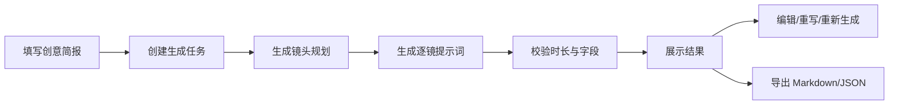

# 视频提示词生成设计

> 版本：v0.1<br>
> 日期：2026-11-23<br>
> 状态：已实现（MVP，测试通过）<br>
> 关联能力：视频提示词逆向、LLM Gateway、视频配方导出

## 1. 结论

需要设计，也需要开发。

“视频提示词逆向”是从已有视频中提取镜头事实和可复刻提示词；“视频提示词生成”是从用户创意、主题或参考风格出发，生成新的可执行镜头方案和提示词。两者的输入、数据模型、交互和输出语义不同，不能只在前端增加一个输入框。

建议把它做成一个独立模块，复用现有的 LLM Gateway、结构化输出、后台任务和 Markdown 渲染能力，不把新逻辑塞进视频上传流水线。

推荐第一阶段先做“创意简报 → 多镜头提示词方案”，再在下一阶段做“从逆向结果二创”。

## 2. 前提假设

本设计按以下理解展开：

1. 用户在输入框中描述想生成的视频，例如主题、产品、人物、场景、风格和时长。
2. 系统生成多个镜头的结构化提示词，而不是直接调用视频生成模型。
3. 输出既可以是单镜头 Prompt，也可以是多镜头 Storyboard。
4. 提示词默认输出英文，可配置中文说明。
5. 生成结果可导出 Markdown 和 JSON，后续可对接可灵、即梦、Runway、Veo、Pika 等模型。

如果目标只是“把一句话改写成一条 Prompt”，可以直接在现有项目详情里加一个小工具，开发量约 1–2 天；但这不是完整的产品级“提示词生成”能力。

## 3. 为什么需要单独设计

- 输入不同：逆向需要视频，生成只需要创意简报。
- 输出不同：逆向输出分析结果，生成输出创作方案。
- 数据不同：生成结果需要保存 Brief、生成参数、Prompt 版本和目标模型。
- 交互不同：生成需要表单、风格选择、镜头数量、目标平台和变体对比。
- 成本不同：生成通常是纯文本调用，不需要抽帧、ASR 和视觉模型。
- 演进不同：后续需要批量生成、版本比较、模型适配和二创。

## 4. 用户场景

### 场景 A：从想法生成分镜提示词

用户输入“15 秒咖啡品牌广告，清晨厨房，暖色自然光，产品特写，目标模型是 Veo”，系统生成 4 个镜头的景别、运镜、画面描述和 Prompt。

### 场景 B：单条视频 Prompt

用户只需要一条可直接粘贴到视频生成工具的 Prompt，系统返回一段英文 Prompt 和可选负向提示词。

### 场景 C：从逆向结果二创

用户选择一个已完成逆向的视频项目，选择“保持节奏，替换主体为香水”，系统复用原片节奏和镜头语言，生成新的提示词方案。

### 场景 D：多版本对比

用户同一 Brief 生成 2–3 个风格版本，对比镜头数和 Prompt 差异，选择一版继续导出。

## 5. 范围

### MVP

- 创意简报表单
- 单镜头或多镜头提示词生成
- 结构化结果展示和修改
- Markdown / JSON 导出
- 生成历史、重新生成和删除
- 失败错误可见
- 认证复用现有基础认证
- Mock 模式可离线跑通

### P1

- 从已完成逆向项目导入参考
- 多版本生成与对比
- 目标模型适配导出
- Prompt 片段的复制、锁定和局部重写
- 生成质量评分和成本统计

### P2

- 直接调用视频生成模型
- 批量生成
- 团队模板库
- Prompt A/B 评测

### 非目标

- MVP 不直接生成视频。
- MVP 不做版权归属判定。
- MVP 不实现复杂工作流编排。
- MVP 不替代现有逆向流程。

## 6. 用户流程



## 7. 输入模型

建议新增 `PromptBrief`：

```python
class PromptBrief(BaseModel):
    title: str = ""
    idea: str
    target_model: str = "generic"
    language: Literal["en", "zh"] = "en"
    duration_s: float = 15.0
    aspect_ratio: str = "16:9"
    shot_count: int = 4
    style: str = ""
    mood: str = ""
    audience: str = ""
    negative_prompt: str = ""
    constraints: list[str] = []
    reference_project_id: str | None = None
```

约束建议：

- `idea` 必填，长度 2–2000。
- `shot_count` 范围 1–8。
- `duration_s` 范围 3–120。
- `reference_project_id` 仅 P1 使用。
- 目标模型先保持字符串，避免枚举阻塞新平台接入。

## 8. 输出模型

建议新增 `PromptPlan` 和 `PromptShot`：

```python
class PromptShot(BaseModel):
    index: int
    start_s: float
    end_s: float
    duration: float
    shot_type: str
    camera_movement: str
    subject: str
    action: str
    scene: str
    lighting: str
    color_palette: list[str]
    prompt: str
    negative_prompt: str = ""
    transition: str = ""
    remake_notes: str = ""


class PromptPlan(BaseModel):
    title: str
    summary: str
    target_model: str
    language: str
    duration_s: float
    aspect_ratio: str
    global_style: str
    shots: list[PromptShot]
    assumptions: list[str]
    warnings: list[str]
```

质量要求：

- 每个镜头 Prompt 必须包含主体、动作、场景、景别、运镜、光线和风格。
- 所有镜头时长之和应与 Brief 的目标时长接近。
- 镜头序号必须连续。
- Prompt 不能只包含“高级感”“电影感”等抽象词。
- 输出必须可被 JSON 和 Markdown 稳定解析。

## 9. API 设计

```text
POST   /api/prompt-projects
GET    /api/prompt-projects
GET    /api/prompt-projects/{id}
POST   /api/prompt-projects/{id}/regenerate
DELETE /api/prompt-projects/{id}
GET    /api/prompt-projects/{id}/export?format=md|json
```

后续 P1 增加：

```text
POST /api/prompt-projects/from-recipe/{project_id}
POST /api/prompt-projects/{id}/variants
```

创建请求示例：

```json
{
  "title": "咖啡广告",
  "idea": "清晨厨房里，一杯热咖啡被倒入玻璃杯，产品特写，温暖自然光",
  "target_model": "veo",
  "duration_s": 15,
  "aspect_ratio": "16:9",
  "shot_count": 4,
  "style": "广告质感",
  "mood": "温暖、安静",
  "negative_prompt": "文字、水印、畸形手指"
}
```

创建后返回任务状态，前端轮询详情接口获取进度和结果。

## 10. 数据模型

MVP 建议新增一张表，避免改动现有逆向表结构：

```text
prompt_projects
├─ id
├─ title
├─ brief_json
├─ plan_json
├─ status
├─ step
├─ progress
├─ error
├─ metrics_json
├─ created_at
└─ updated_at
```

设计理由：

- 生成结果通常是一个整体方案，无需像逆向 Shot 一样单独查询。
- 新增表可由现有 `create_all` 自动创建，不需要破坏性迁移。
- `brief_json` 保留原始输入，便于重新生成和对比。
- `plan_json` 保存完整结构化结果，后续再加版本表也不困难。

## 11. 架构与模块

建议新增：

```text
app/
├─ api/prompt_routes.py
├─ services/prompt_generation.py
├─ services/prompt_export.py
├─ prompts/video_prompt_generation.md
├─ templates/prompt_plan.md.j2
├─ schemas.py                 # 增加 PromptBrief / PromptPlan / PromptShot
├─ models.py                  # 增加 PromptProject
└─ static/app.js              # 增加生成模式和结果渲染
```

复用：

- `LLMGateway`：文本模型调用、用量统计。
- `BackgroundTasks`：MVP 异步生成。
- 现有 Basic 认证。
- 现有数据目录和 SQLite。
- 现有 Markdown/JSON 导出模式。

不复用：

- 不复用 `ShotAnalysis`，避免把来源判定、置信度和证据等逆向字段硬塞进生成结果。
- 不复用视频流水线，生成任务不探测、不分镜、不抽帧。

## 12. Prompt 生成策略

建议拆成两步：

1. 镜头规划：根据 Brief 生成镜头数量、时长分配、景别和叙事节奏。
2. 逐镜提示词：为每个镜头生成可执行英文 Prompt、负向词和注意事项。

也可以一次结构化调用完成，但两步更利于校验和局部重试。

降级策略：

- 结构化输出失败 → JSON 解析。
- 单镜生成失败 → 重试一次。
- 仍失败 → 使用 Mock 镜头，并标记 `degraded=true`。
- 任务整体失败 → 保留 Brief，允许重新生成。

## 13. 前端设计

建议工作台增加两个模式：

```text
[逆向视频] [生成提示词]
```

生成模式包含：

- 左侧 Brief 表单
- 目标模型、时长、画幅、镜头数
- 风格、情绪、负向提示词
- 生成、重新生成、复制全部
- 右侧结果卡片
- 每镜 Prompt 复制按钮
- Markdown / JSON 下载
- 失败和降级提示

生成中禁止重复提交，完成后开放导出。未完成或失败时不显示可用下载链接。

## 14. 错误与成本

- 输入不合法：`422`，前端表单提示。
- 模型超时：任务标记失败，保留 Brief，可重试。
- 结构化解析失败：降级到 JSON 解析。
- 单镜失败：重试一次，仍失败则标记该镜降级。
- 默认限制 8 个镜头，避免成本和延迟失控。
- 记录调用次数、输入 token、输出 token 和总耗时。

## 15. 安全与合规

- 所有生成接口复用现有 Basic 认证。
- 不允许把 API Key 写入 Brief 或输出。
- 对真实人物、知名 IP、暴力和其他敏感请求增加提示词安全约束。
- 明确输出是创作建议，不承诺模型生成效果。
- 继续遵守“只输出提示词，不提供侵权素材下载”的产品边界。

## 16. 测试计划

### 单元测试

- `PromptBrief` 参数校验。
- `PromptPlan` 时长和镜头序号校验。
- Mock 生成结果稳定性。
- Markdown / JSON 渲染。
- 目标模型导出格式。

### 集成测试

- 创建任务并轮询完成。
- 空 Brief、镜头数越界、时长越界。
- 模型失败后任务失败且可重试。
- 未认证接口返回 `401`。
- 导出接口返回正确的附件头。

### 回归测试

- 视频逆向流程不受影响。
- 现有认证和媒体接口不被破坏。
- 现有 `pytest` 全部通过。

## 17. 验收标准

- [x] 输入 Brief 后生成 1–8 个镜头。
- [x] 每个镜头包含完整 Prompt 和必要字段。
- [x] 镜头时长之和与目标时长误差可接受。
- [x] 可复制单个 Prompt 和全部 Prompt。
- [x] 可下载 Markdown 和 JSON。
- [x] 失败后可重新生成。
- [x] 未完成状态不显示有效下载链接。
- [x] Mock 模式可离线跑通。
- [x] 认证和现有逆向测试全部通过。

## 18. 开发估算

MVP 约 5–8 个开发日：

| 工作 | 估算 |
|------|------|
| 数据模型、Schema、API | 1–2 天 |
| 生成服务、Prompt 模板、Mock | 1–2 天 |
| 前端模式与结果页 | 2–3 天 |
| 导出、测试、联调 | 1–2 天 |

如果只做“一句话生成一条 Prompt”，约 1–2 天，但无法覆盖多镜头、历史、重试和导出。

## 19. 最终判断

需要开发。

建议先做独立 MVP，不直接接入视频生成模型。这样能以较低成本验证用户是否真的需要“创意 → 分镜 → Prompt”的完整链路，同时复用现有 LLM 和认证能力。

开发顺序建议：

1. Schema、数据库表和 Mock 生成。
2. LLM 生成服务和导出。
3. API 与任务状态。
4. 前端生成模式。
5. 测试与可用性回归。
6. P1 再接“从逆向结果二创”和目标模型适配。

## 20. 实现记录

2026-11-23 完成 MVP：

- 数据层：新增 `prompt_projects` 表，保存 Brief、结构化方案、任务状态、错误和模型用量。
- 服务层：新增 `prompt_generation` 与 `prompt_export`，支持结构化输出、JSON 解析降级、Mock 方案、时长与镜头序号归一化。
- API：支持创建、列表、详情、重新生成、删除，以及 Markdown / JSON 导出。
- 前端：工作台新增“生成提示词”模式，支持 Brief 表单、进度轮询、逐镜复制、全部复制、重生成和删除。
- 测试：新增 Brief 校验、Mock 稳定性、时间线归一化、导出、完整接口生命周期和鉴权测试；全量 `pytest` 42 项通过。

当前边界与设计一致：只生成视频提示词方案，不直接调用视频生成模型；从逆向结果二创、多版本对比和目标模型专属适配仍属于 P1。
